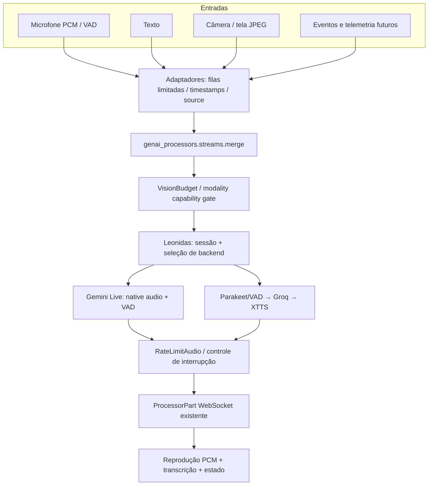

# Universal AI — Arquitetura proposta e primeira implementação

**Status:** proposta técnica + runtime v0.1 aditivo (sem migração compulsória).
**Produto inicial:** conversação multimodal em tempo real.
**Plataforma futura:** IA incorporada em simuladores, robôs e drones com
interfaces e validações específicas por dispositivo.

## 1. Contexto e decisões

O repositório **já implementa** uma aplicação conversacional madura em
`leonidas/`: Gemini Live 2.5/3.1, cascata Parakeet/Groq/XTTS, WebUI Vite,
WebSocket `ProcessorPart`, VAD, interrupção, readiness de workers, telemetria
e testes. `examples/live_commentator/` também permanece uma referência
funcional. **Não os substituir, clonar ou alterar APIs públicas** nesta fase.

Decisões:

1. `genai_processors` continua a biblioteca de `Processor`, `ProcessorPart`,
   `ProcessorStream`, `streams.merge` e composição. Não criar um novo SDK
   de streaming que concorra com estes contratos.
2. `leonidas` permanece **composition root**, dono do lifecycle, UI, provedores,
   credenciais e protocolos existentes. `universal_ai` fornece contratos e
   processadores **aditivos e opt-in**; não depende do Leonidas.
3. Nenhum modelo deve ter controle direto de hardware. Em fases futuras, um
   `SafetySupervisor` e um controlador determinístico, fora do pipeline de
   inferência probabilística, serão obrigatórios.
4. Seleção de backend **por capacidade**, não por fragmentos do model ID. O
   pipeline Gemini Live e o pipeline cascata são semanticamente distintos.
5. Não persistir áudio, frames, tela, prompts nem transcrições por padrão.
   Gravação/replay precisa de consentimento, retenção definida e redaction.

## 2. Fluxo de dados



O `merge` ordena por **chegada**, não por timestamp. `ua_received_ns` é um
relógio monotônico **local ao processo**; não deve ser usado para comparar
clocks de máquinas diferentes. Para sensores externos, preservar `capture_time`
com clock/domain declarados e introduzir sincronização explícita com watermarks.

## 3. Contratos entregues na v0.1

- `ProviderCapabilities`: modalidades de entrada/saída, barge-in, áudio nativo.
- `ConversationNeeds`: requisitos obrigatórios; falha explícita quando o
  backend não oferece a modalidade ou interrupção solicitada.
- `SourceSettings` + `BoundedIngress`: fila limitada por origem. `audio`,
  `text` e `control` usam backpressure; `image`/`telemetry` podem substituir
  os dados mais antigos. A política de fechamento não garante a entrega de
  todos os frames substituíveis.
- `StampSource`: preserva a mídia e anota `ua_source`, `ua_sequence`,
  `ua_received_ns`, sem sobrescrever metadados preexistentes da origem.
- `VisionBudget`: limita FPS e descarta frames `realtime` obsoletos; não altera
  áudio, texto, mensagens de status nem interrupções.
- `merge_sources`: multiplexa streams de fontes independentes usando o
  `streams.merge` do próprio GenAI Processors.
- `compose_conversation`/`run_conversation`: valida capacidades e executa
  `VisionBudget + backend` dentro de `processor.context()`.
- `wrap_leonidas_pipeline`: traduz os dois IDs reais do Leonidas para
  capacidades genéricas. Integração é **opt-in** e ainda não é usada pelo
  launcher existente. Não duplica limitação de áudio.

**Importante:** `StampSource` usa `received_ns`; o limite de idade é aplicado
antes do modelo e não substitui a política de backpressure nas fontes. A
primeira versão não promete prioridade hard-real-time ou entrega exactly-once.

## 4. Conversação v0.1: o que existe, o que falta

| Área | Já disponível no Leonidas | Novo / próximo passo |
| --- | --- | --- |
| Voz full duplex | Gemini Live + cascata local | Adaptadores padronizados |
| Interrupção | Native VAD / VAD híbrido / flush | Contract tests cross-provider |
| Camera/tela | Gemini Live com limites de frame | Frame budget reutilizável |
| Gerência de sessão | `leonidas.runtime.SessionManager` | Interface multi-session futura |
| Capabilities | `leonidas.capabilities` | Negociação independente de SDK |
| Logs/métricas | Logs redigidos e metrics | SLOs por fonte/modelo |
| Múltiplos sensores | Captura do navegador | Stamp + merge + ingress por origem |
| Memória persistente | **Não há por padrão** | Consentimento e storage opt-in |
| Skills/robótica | **Fora do escopo** | Controller + supervisor separados |

### Estados de conversa

`disconnected → connected → listening → thinking → speaking`. Entrada do usuário
pode provocar `interrupted → listening`, com esvaziamento imediato do playback
atrasado. `error`/`stopped` limpam tarefas e recursos de sessão. O frontend
deve observar eventos `ProcessorPart` do backend, sem deduzir interrupção de
textos gerados. `generation_complete` e `audio_stream_end` continuam distintos.

### Papel de `LiveProcessor`

- `core.live_model.LiveProcessor`: sessão Gemini Live com estado no provedor,
  ferramentas, áudio, visão e VAD nativos.
- `core.realtime.LiveProcessor`: transforma um `turn_processor` finito em
  sessão com rolling prompt e cancelamento. Exige VAD/STT/TTS apropriados e
  gerenciamento de turnos local; não é um substituto transparente do Gemini
  Live. Frames retidos no rolling prompt podem ser retokenizados.

## 5. API-alvo extensível (roadmap, não implementação atual)

```text
SensorAdapter   -> AsyncIterable[ProcessorPart]
PerceptionModel -> Processor[observations]
WorldState      -> synced state + uncertainty + clock domain
SkillPlanner    -> high-level intent + constrained plan
SafetySupervisor-> allow/deny/clip with independent limits
DeviceAdapter   -> actuator driver / simulator-specific commands
```

Um comando semântico (`navigate_to`, `look_at`, `answer_question`) precisa de
uma tradução validada para cada corpo/ambiente. O mesmo `Processor` não pode
pressionar teclas no GTA e emitir comandos MAVLink sem adaptadores específicos.

## 6. Metas de latência e observabilidade

Metas iniciais **a validar empiricamente**, não SLA: p95 end-to-first-audio
abaixo de 1000 ms nas condições de teste; interrupção audível abaixo de
250 ms; frame age abaixo de 2 s; filas com profundidade limitada. Registrar
TTFA, latência de STT/LLM/TTS, número de frames descartados, profundidade das
filas, interrupções e cancelamentos. Métricas por sessão sem conteúdo pessoal.

## 7. Roadmap incremental

1. **v0.1 (esta PR):** contratos, filas limitadas, stamp, FPS budget,
   multiplexação, bridge Leonidas opt-in, demo offline, testes e arquitetura.
2. **v0.2:** instrumentação por `ProcessorPart` + tracing sem payload; WebUI
   exibindo latência/interrupt/drop por origem; testes de reconnect e áudio.
3. **v0.3:** integração opt-in no `PipelineRegistry` com fallback seguro,
   e E2E Gemini/cascata. Nenhuma mudança automática de modelo/voz/transport.
4. **v0.4:** abstrações STT/LLM/TTS e memória controlada por consentimento.
5. **v0.5:** câmera/tela e telemetria sincronizadas, replay determinístico
   sintético, e skill/tool registry com permissões.
6. **Futuro:** simuladores GTA/MuJoCo/Gazebo; para hardware físico adicionar
   supervisão independente, watchdog, E-stop, limites e testes em sandbox.

## 8. Segurança, privacidade e compatibilidade

- Preservar `ProcessorPart` e seus substreams: `realtime`,
  `input_transcription`, `output_transcription`, `application/x-state` e todos
  os metadados de controle (`interrupted`, `turn_complete`, `audio_stream_end`).
- Nunca registrar payload bruto de microfone, câmera, tela, transcrições,
  prompts ou secrets em logs/traces por padrão.
- Servidor legado fica em `127.0.0.1`; antes de LAN/WAN requer auth, TLS,
  validação Origin, quotas, isolamento por sessão e política de armazenamento.
- Não acrescentar dependências CUDA ao núcleo da biblioteca. Modelos locais
  continuam em ambientes/processos opcionais.
- Controladores de drones/robôs exigem fallback e limites independentes; um
  sistema conversacional não deve adquirir permissão de atuação automaticamente.
- Uma PR de migração do Leonidas requer testes de regressão de Gemini 2.5/3.1,
  Parakeet/Groq/XTTS, playback PCM, barge-in e WebUI, além de smoke real opcional.

## 9. Como validar

```bash
python -m unittest discover -s universal_ai/tests -p '*_test.py'
python -m examples.universal_conversation.demo
python -m pytest leonidas/tests
cd leonidas/webui && npm test && npm run build
```

O primeiro comando testa sem provedores externos (mas `streaming_test.py`
requer a instalação local do pacote). E2E Gemini/Groq permanece opt-in, com
credenciais do usuário, hardware e permissões adequadas. Ver também
`leonidas/README.md`, `leonidas/SPECS.md` e `AGENTS.md`.
